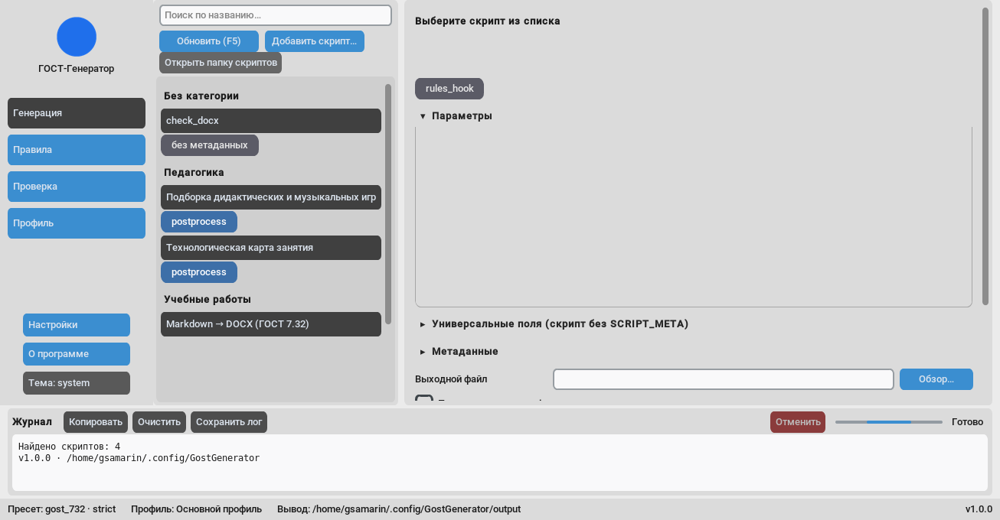

# ГОСТ-Генератор

Desktop-приложение (GUI + CLI) для создания и проверки учебных `.docx` по ГОСТ 7.32
и методичке «Мультиворк»: рефераты, отчёты по практическим, лабораторные, курсовые, ВКР,
а также педагогические документы (технологические карты, конспекты, подборки игр).

Одно ядро `app/core`, две оболочки: `app/ui` (CustomTkinter) и `gost` (CLI для агентов).
Полностью офлайн; runtime-зависимости ровно две: `customtkinter`, `pillow`.
Работа с DOCX — только stdlib (`zipfile`, `xml.etree.ElementTree`).



## Три сценария

1. **Новый скрипт из чата** — положили `.py` в `scripts/`, заполнили форму, получили `.docx`.
2. **Смена правил** — правите пресет в GUI, генерация и проверка идут по этим же правилам.
3. **Проверка готового файла** — структурированный отчёт (ошибки/предупреждения/рекомендации)
   с указанием места и подсказкой; пакетный режим по папке.

## Запуск на Debian

```bash
sudo apt install python3-tk            # tkinter для GUI
python3 -m venv venv && source venv/bin/activate
pip install -r requirements-dev.txt
python -m app                          # GUI
python -m app.cli context --json       # CLI без дисплея
python -m unittest discover -s tests -v
```

CLI работает headless и не импортирует GUI (`app/cli.py` → только `app/core`).

## Сборка exe

exe собирается **только под Windows** (ограничение PyInstaller — см. FAQ).
Релиз делает GitHub Actions: push тега `v*` → `dist/GostGenerator.exe` (GUI, windowed)
и `dist/gost.exe` (CLI, console) → архив с `scripts/ presets/ profiles/ portable.flag README.txt`.
Локально на Windows: `pyinstaller build.spec --noconfirm`.
На Linux/Wine цель `make build-win-local` — только для экспериментов.

Сам `build.spec` можно проверить под своей ОС, не собирая exe: PyInstaller строит архив по
статическому графу импортов, а ядро подключается динамически, поэтому модули `app.core.*`
обязаны быть в `hiddenimports` (берутся из `cli_core.CORE_MODULES`). Проверка на Linux:

```bash
venv/bin/python -m PyInstaller build.spec --noconfirm \
    --distpath dist_local --workpath build_local
./dist_local/gost doctor --json | grep -A1 core.docx_inspector   # должен быть "ok"
./dist_local/gost check tests/fixtures/fixtures_good.docx --format json --fail-on error
```

Workflow лежат в корне репозитория (`.github/workflows/`), потому что GitHub не видит
`.github` во вложенных папках: `ci.yml` — тесты на Linux и Windows при каждом push,
`build-windows.yml` — сборка и smoke-проверка exe.

## Пункт меню в Linux

`make desktop` (он же `sh packaging/install-linux-desktop.sh`) без прав суперпользователя
регистрирует «ГОСТ-Генератор» в `~/.local/share/applications`, кладёт лаунчер
`packaging/gost-generator` в `~/.local/bin` и иконку в `~/.local/share/icons/hicolor`.

## Как добавить свой скрипт-генератор

Положите `.py` в каталог `scripts/` и объявите метаданные — приложение построит форму само:

```python
SCRIPT_META = {
    "name": "Технологическая карта ООД",
    "description": "Генерация тех.карты занятия по развитию речи",
    "category": "Педагогика",
    "version": "1.0",
    "input": "none",              # none | file_md | file_docx | text | folder
    "output_ext": ".docx",
    "arg_template": ["--out", "{output}", "--rules", "{rules_json}", "--meta", "{meta_json}"],
    "rules_hook": "postprocess",  # native | constants | postprocess | none
    "params": [
        {"id": "theme", "label": "Тема занятия", "type": "text", "default": ""},
        {"id": "age_group", "label": "Возрастная группа", "type": "select",
         "options": ["2-3", "3-4", "4-5", "5-6", "6-7"], "default": "3-4"},
        {"id": "duration_min", "label": "Длительность, мин", "type": "int", "default": 15},
    ],
}
```

Требования к скрипту: только stdlib, без сети, без `input()`, без `shell=True`;
итоговый путь в stdout, диагностика в stderr, код возврата 0 при успехе.
Скрипт без `SCRIPT_META` тоже запускается — форма будет универсальной
(вход/выход/доп. аргументы), а кнопку «Сохранить описание» можно использовать
для sidecar-файла `scripts/<name>.meta.json`. Проверка: `gost scripts validate <name>`.

Стратегии применения правил (`rules_hook`):

| Хук | Как работают правила |
|---|---|
| `native` | скрипт получает правила и строит документ по ним |
| `constants` | раннер патчит модульные константы скрипта и вызывает `build` |
| `postprocess` | после генерации файл пропускается через нормализатор (по умолчанию) |
| `none` | правила не применяются (служебные скрипты) |

## Структура конфигов

```text
presets/*.json    пресеты правил (gost_732, multivork, pedagogical, free + пользовательские)
profiles/*.json   профили метаданных (плоский словарь meta уходит скриптам)
state.json        активный пресет/профиль, каталоги, тема, таймаут, recent files, геометрия
gost.json         конфигурация проекта (переопределяет пользовательскую)
```

Порядок приоритетов настроек: флаги → `GOST_RULES/GOST_PROFILE/GOST_HOME/GOST_OUTPUT` →
`gost.json` проекта → пользовательский конфиг (`~/.config/GostGenerator`, Windows: `%APPDATA%\GostGenerator`) → дефолты.
Portable-режим: файл `portable.flag` рядом с exe — данные живут рядом с ним.

## CLI для ИИ-агентов

```bash
gost context --json
gost job run task.json --json
gost check out.docx --rules gost_732 --format json --fail-on error
gost fix out.docx --rules gost_732 --json
```

stdout — только JSON-конверт `{"schema_version","ok","command","data","errors","warnings"}`,
stderr — логи. Коды возврата: 0 ок, 1 нарушения, 2 аргументы, 3 файл не найден,
4 скрипт упал, 5 таймаут, 6 конфиг, 7 нормализация. Подробности — `AGENTS.md`, примеры — `examples/README.md`.

## FAQ

**Почему exe не собирается на Linux?**
PyInstaller собирает бинарь под ту ОС, на которой запущен: на Linux он даст Linux-исполняемый
файл, а не `GostGenerator.exe`. Windows-exe — только на Windows-runner (CI) или локально на Windows.

**Приложение под Windows берёт скрипты откуда?**
При первом старте встроенные `scripts/ presets/ profiles/` распаковываются в каталог данных
(рядом с exe при `portable.flag`, иначе в `%APPDATA%\GostGenerator`).

**Где логи?**
`logs/YYYY-MM-DD_HHMMSS.log`, хранится последние 30 сессий.

**Можно ли править OOXML вручную, чтобы починить оформление?**
Нет — используйте `gost fix` / кнопку «Проверить и исправить»: он идемпотентен и делает бэкап.

**Скрипт завис/падает** — в настройках включите «Использовать внешний Python» и укажите путь
к интерпретатору с нужными зависимостями; по умолчанию внутренний режим.

**Проверка находит «лишние» нарушения у педагогической тех.карты**
Не применяйте ГОСТ-пресет к педагогическим документам — используйте `pedagogical`.

## Лицензия и статус

Версия 1.0.0. История — `CHANGELOG.md`, решения — `DECISIONS.md`,
требования — `PROMT.md` (ТЗ), правила агентной работы — `AGENTS.md`.
